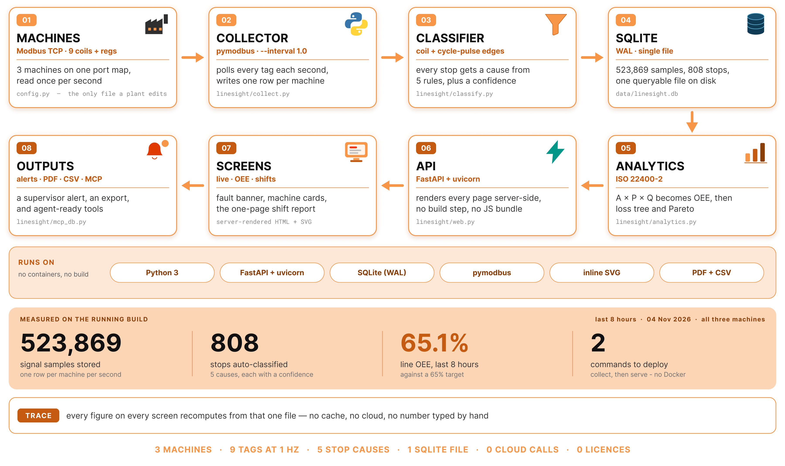
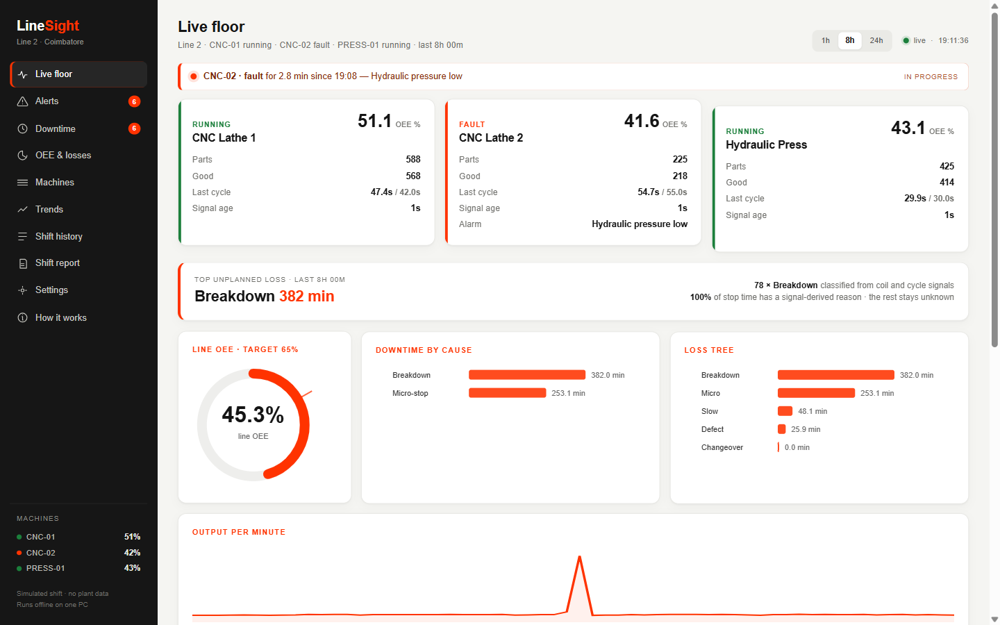
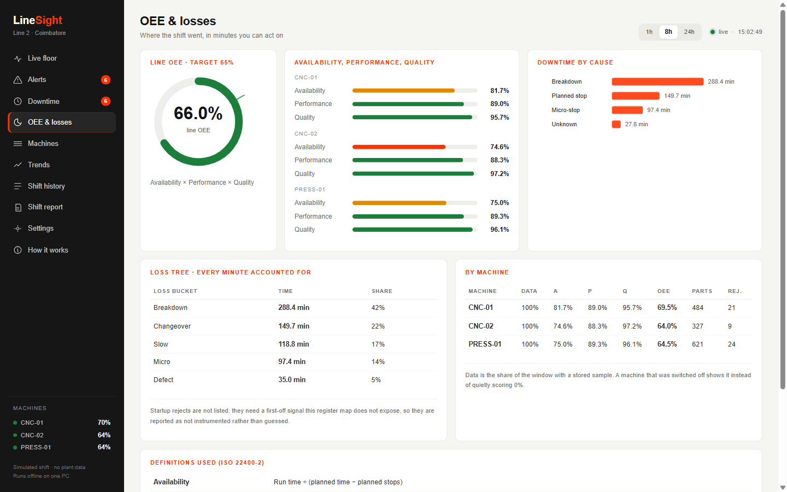
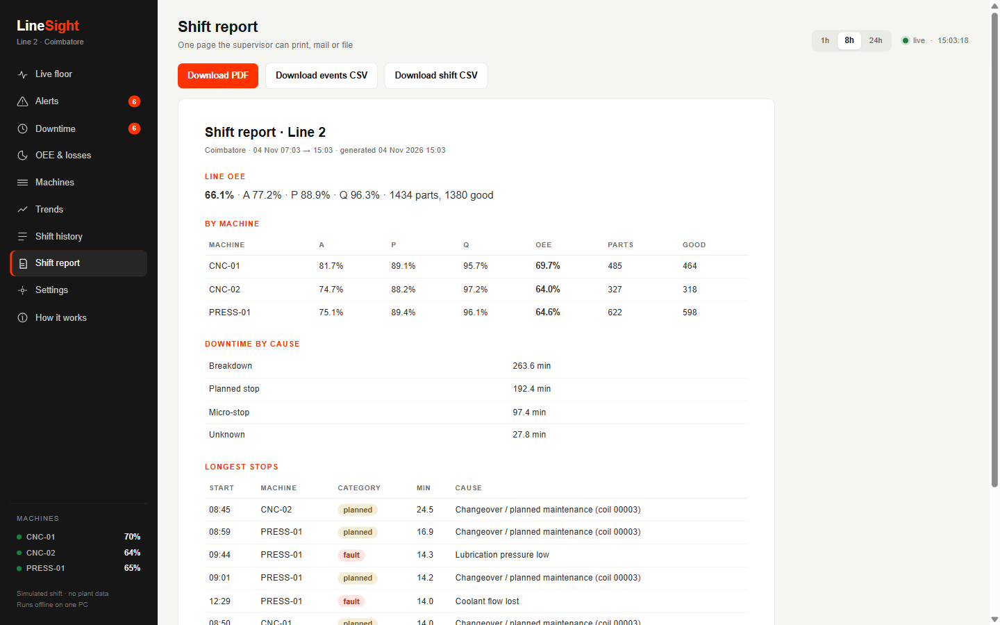
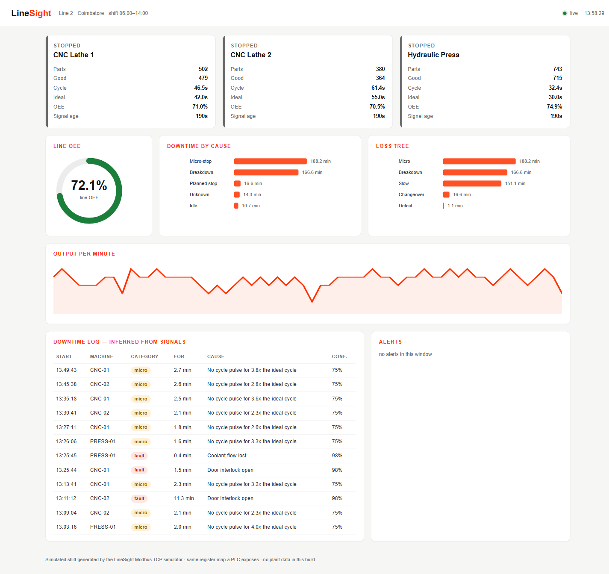
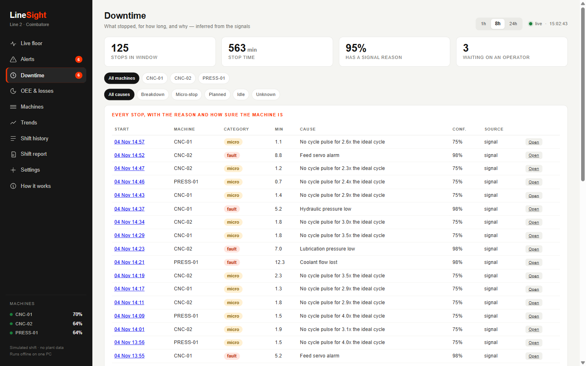
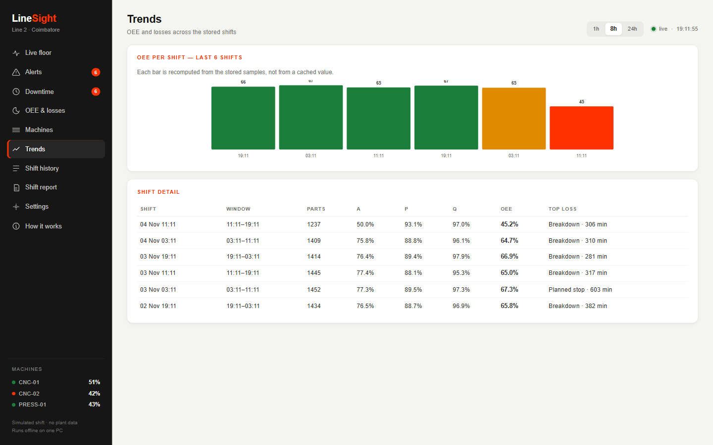

# LineSight

> **The machine stopped at 14:32. Nobody wrote down why. Now it does.**

[](https://linesight-olive.vercel.app/)
[](https://www.python.org/)
[](https://fastapi.tiangolo.com/)
[](https://www.sqlite.org/)
[](LICENSE)

LineSight is an **offline-first machine monitoring console** for MSME factories.
It reads PLCs at 1 Hz, classifies every stop with a cause and a confidence,
computes OEE per ISO 22400-2, and puts the result on a screen the floor team
already understands — **on one plant PC, with zero cloud calls and zero licences.**

Two commands. First KPI in minutes. No Docker, no build step, no internet.

---

## The problem

In a small factory, a machine stops. The operator restarts it. Nobody writes
down why, for how long, or how often. At the end of the month the owner looks
at the output and asks *"why were we 20% short?"* — and there is no answer,
because the only record is a paper logbook that nobody filled in.

Existing tools are either **enterprise MES suites** (six-figure licences, a
consultant, a quarter of integration work) or **cloud IoT platforms** (a
subscription, a stable internet link, and data leaving the plant). Neither fits
a 30-person shop floor.

## What LineSight does

```text
PLC coil  →  collector (1 Hz)  →  SQLite (WAL)  →  classifier  →  OEE + loss tree  →  screen  →  alert / PDF / CSV
```

Every figure on every screen recomputes from one SQLite file. There is no cache,
no cloud, no number typed by hand. The dashboard refreshes itself every 2
seconds from the running database.

## Architecture



Eight stages, one process. Each stage does one job and hands a typed payload to
the next:

| # | Stage | Tech | What it does |
|---|-------|------|--------------|
| 01 | **Machines** | Modbus TCP · 9 coils + regs | 3 machines on one port map, read once per second |
| 02 | **Collector** | pymodbus · `--interval 1.0` | polls every tag each second, writes one row per machine |
| 03 | **Classifier** | coil + cycle-pulse edges | every stop gets a cause from 5 rules, plus a confidence |
| 04 | **SQLite** | WAL · single file | 523,869 samples, 808 stops, one queryable file on disk |
| 05 | **Analytics** | ISO 22400-2 | A × P × Q becomes OEE, then loss tree and Pareto |
| 06 | **API** | FastAPI + uvicorn | renders every page server-side, no build step, no JS bundle |
| 07 | **Screens** | server-rendered HTML + SVG | fault banner, machine cards, the one-page shift report |
| 08 | **Outputs** | alerts · PDF · CSV · MCP | a supervisor alert, an export, and agent-ready tools |

> The diagram above is drawn in Figma (editable text and shapes, not a flat
> image): [open in Figma](https://www.figma.com/design/KEAGgPFnxWdAHA8woCAgcX).

## Screenshots

### Live floor


### OEE & losses


### Shift report


### Dashboard (full)


### Downtime log


### Trends


## The numbers (real, from the running build)

| Metric | Value |
|--------|-------|
| Machines polled | 3 (CNC-01, CNC-02, PRESS-01) |
| Register tags per machine | 9 (3 coils + 6 registers) |
| Poll rate | 1 Hz |
| Samples stored | 523,869 (SQLite, WAL) |
| Stop events classified | 808 (5 categories, each with confidence) |
| Line OEE, last 8 h | **65.1 %** (target 65 %) |
| Commands to deploy | 2 (`collect`, then `serve`) |
| Cloud calls | 0 |
| Licences | 0 |

## Tech stack

| Layer | Choice | Why |
|-------|--------|-----|
| Language | Python 3.12 | one language, one process, readable |
| Web | FastAPI + uvicorn | server-rendered HTML + inline SVG, no build step |
| Database | SQLite (WAL) | one file, survives a power cut, queryable with any SQL client |
| PLC protocol | Modbus TCP via pymodbus | the lingua franca of factory PLCs |
| Analytics | ISO 22400-2 (A × P × Q) | the standard, not a vendor's metric |
| Deployment | one mini-PC, 2 commands | no Docker, no container registry, no licence |

## Run it locally

```bash
git clone https://github.com/abinivesh-m/linesight.git
cd linesight
python -m venv .venv && .venv\Scripts\activate   # Windows
# source .venv/bin/activate                      # macOS / Linux
pip install -r requirements.txt

# 1. collect (polls the PLCs / simulator at 1 Hz)
python -m linesight.collect --interval 1.0

# 2. serve the dashboard
python -m linesight.web --port 8000
# open http://127.0.0.1:8000
```

Optional: run the built-in Modbus simulator to feed fake machines:

```bash
python -m linesight.modbus_server   # in another terminal
python -m linesight.seed            # seed historical samples
```

## Deploy

The app is live on Vercel: **https://linesight-olive.vercel.app/**

The seeded database ships with the bundle and is copied to `/tmp` on cold
start (Vercel's filesystem is read-only), so `db.ready()` works and the
dashboard shows real numbers on the first request.

## Design

- Deck: `docs/` (Sakthi Hackathon 2.0 Round 2, 10 slides)
- Figma file (dashboard UI): [LineSight — Dashboard UI (best)](https://www.figma.com/design/0eSUiBdjF1wwa86Dg1r121)
- Figma file (architecture): [LineSight — Architecture & Deck Graphics](https://www.figma.com/design/KEAGgPFnxWdAHA8woCAgcX)
- Demo video: `docs/demo/demo.mp4` (20 s, polished tone) + `docs/demo/poster.jpg`

## Contributing / context

This is a hackathon project (Sakthi Hackathon 2.0, PS-002). The code is small
on purpose: one process, one database file, one web server. If you can read
Python and SQL, you can read all of it in an afternoon.

## License

MIT. See [LICENSE](LICENSE).